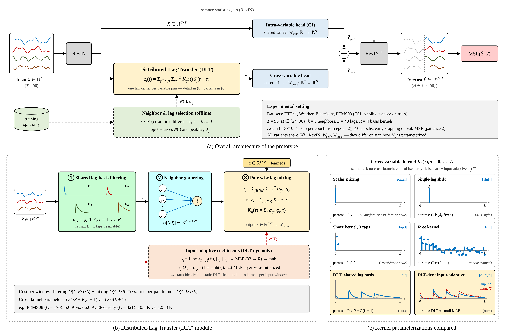

# DLT: Distributed-Lag Transfer for Multivariate Time Series Forecasting

> **中文简介**：本仓库是 DLT（跨变量分布滞后传递）方向的可行性原型。核心思想是为每对相关变量学习一条**多时滞核** K_ij(τ)，用共享的时滞基降低参数量，并让核系数随输入窗口自适应（DLT-dyn）。
> 仓库包含线性原型代码、69 组对比实验的原始结果和架构图（SVG/PDF/PNG）。这些是可行性验证结果，不是论文最终结果。



## Idea
Cross-variable effects in multivariate series are often **lagged and spread over several lags**
(e.g. upstream → downstream traffic sensors). Existing channel-dependent models either mix whole
series with one scalar per pair (iTransformer/VCformer-style), shift a source by a single estimated
lag (LIFT / TLGNN / DTLGSL-style), or use very short static kernels (CrossLinear-style).
**DLT** gives every target–source pair its own multi-lag kernel

$$z_i(t)=\sum_{j\in N(i)}\sum_{\tau=0}^{L}K_{ij}(\tau)\,\tilde x_j(t-\tau),\qquad K_{ij}(\tau)=\sum_{r=1}^{R}\alpha_{ijr}\,\phi_r(\tau)$$

with a small bank of shared basis kernels φ_r (cost linear in the number of variables), and
**DLT-dyn** makes α input-adaptive: α_ijr(X) = α_ijr · (1 + tanh(MLP([s_i ‖ s_j]))).

## Feasibility prototype
All variants share RevIN, the same top-k neighbour sets N(i) (selected offline by |CCF| on the
training split), the same intra-variable head W_self and cross head W_cross. **They differ only in
how K_ij(τ) is parameterised:**

| variant | K_ij(τ) | resembles |
|---|---|---|
| `ci` | no cross branch | RLinear |
| `scalar` | a_ij at τ = 0 | iTransformer / VCformer-style mixing |
| `shift` | a_ij at τ = d_ij (CCF peak lag) | LIFT / TLGNN / DTLGSL-style |
| `tap3` | free, τ = 0..2 | CrossLinear-style |
| `dlt` | Σ_r α_ijr φ_r(τ), shared basis | **proposed** |
| `full` | free, τ = 0..L | unconstrained upper bound |
| `scalardyn` | `scalar` with input-adaptive a_ij | control: dynamics without a lag kernel |
| `dltdyn` | `dlt` with input-adaptive α | **proposed (dynamic)** |

Settings: lookback T = 96, horizon H ∈ {24, 96}; k = 8 neighbours, L = 48 lags, R = 4 basis kernels;
Adam (lr 3e-3, ×0.5 per epoch from epoch 2), ≤ 6 epochs, early stopping on validation MSE
(patience 2); Time-Series-Library splits (PEMS08 6:2:2), z-score on train; CPU only.

## Results (69 runs)
MSE on the z-scored test set, mean over seeds (¹ = single seed); % = change vs. `ci`; bold = best per column.

| variant | ETTh1 H=96 | Weather H=96 | Electricity H=96 | PEMS08 H=24 | PEMS08 H=96 |
|---|---|---|---|---|---|
| CI (no cross) | **0.3895 (+0.0%)** | 0.1932 (+0.0%) | 0.1975 (+0.0%)¹ | 0.2326 (+0.0%) | 1.1678 (+0.0%) |
| scalar mixing | 0.3900 (+0.1%) | 0.1747 (-9.5%) | 0.1902 (-3.7%)¹ | 0.1904 (-18.1%) | 1.0170 (-12.9%) |
| single-lag shift | 0.3899 (+0.1%) | 0.1750 (-9.4%) | 0.1895 (-4.0%)¹ | 0.1944 (-16.4%) | 1.0375 (-11.2%)¹ |
| 3-tap kernel | 0.3897 (+0.0%) | 0.1730 (-10.5%) | 0.1875 (-5.1%)¹ | 0.1853 (-20.3%) | 0.9295 (-20.4%) |
| DLT (static) | 0.3927 (+0.8%) | 0.1665 (-13.8%) | 0.1866 (-5.5%)¹ | 0.1794 (-22.9%) | 0.8634 (-26.1%) |
| free kernel | 0.3934 (+1.0%) | 0.1694 (-12.3%) | – | 0.1805 (-22.4%) | 0.8568 (-26.6%)¹ |
| scalar + dynamic (control) | 0.3933 (+1.0%) | 0.1717 (-11.1%) | 0.1826 (-7.5%)¹ | 0.1495 (-35.7%) | 0.7205 (-38.3%) |
| DLT-dyn | 0.4083 (+4.8%) | **0.1637 (-15.3%)** | **0.1725 (-12.7%)¹** | **0.1328 (-42.9%)** | **0.5522 (-52.7%)** |

Key observations:
1. **Multi-lag kernels beat single-lag shifts and scalar mixing** on every coupled dataset
   (static DLT vs. `shift`: −4.9 / −1.5 / −7.7 / −16.8 % on Weather / Electricity / PEMS08-24 / PEMS08-96).
2. **The shared basis matches the free kernel** (better on Weather and PEMS08-24, 0.8 % worse on PEMS08-96)
   with ~12× fewer cross-kernel parameters (PEMS08: 5.6 K vs. 66.6 K).
3. **Input-adaptive kernels give the largest gain and need the lag kernel**: DLT-dyn beats the
   dynamic scalar control by 4.7 / 5.5 / 11.2 / 23.4 % and is more stable across seeds
   (PEMS08-96: 0.555 / 0.549 vs. 0.681 / 0.760).
4. **Weakly coupled data (ETTh1) does not benefit**; DLT-dyn overfits there (+4.8 %) — a gate /
   regulariser is needed before full benchmarking.

Premise check (`code/pems_lag.py`): on PEMS08 road edges, 52 % of upstream→downstream pairs peak at
a one-step (5 min) lead, and 65 % spread their response over ≥ 2 lags.

Caveats: linear prototype, ≤ 6 epochs, no tuning, 1–2 seeds, lookback 96 only; absolute errors are far
from deep state-of-the-art models — only the relative comparison between variants is meaningful.

## Repository layout
```
code/proto.py        prototype model + training/eval (all 8 variants)
code/pems_lag.py     lag premise check on PEMS08 road edges
code/agg.py          console summary of a runs file
code/agg_md.py       markdown results table (results/summary.md)
code/make_arch.py    generates figures/dlt_architecture.svg
code/render.js       SVG -> PNG/PDF with Playwright Chromium
scripts/download_data.sh   fetch datasets into ./data (not tracked)
scripts/run_grid.sh        reproduce all 69 runs
results/runs.jsonl   one JSON line per run (MSE, MAE, params, time, lag statistics)
results/summary.md   results table
figures/             architecture figure (SVG: editable/Visio-importable; PDF: vector for LaTeX; PNG: 4800×3180)
```

## Reproduce
```bash
pip install -r requirements.txt
bash scripts/download_data.sh

# a single run
python code/proto.py --data PEMS08 --pred_len 96 --root data --variant dltdyn --out results/my_runs.jsonl

# the full grid (CPU; ~1–2 h with 4 workers), then the table
bash scripts/run_grid.sh
python code/agg_md.py results/runs_reproduced.jsonl

# lag premise check and the figure
python code/pems_lag.py data/PEMS08.npz data/PEMS08_edges.csv
python code/make_arch.py figures/dlt_architecture.svg
node code/render.js figures/dlt_architecture.svg figures/dlt_architecture.png figures/dlt_architecture.pdf 3
```

## Next steps
Gate/regulariser for weakly coupled data; port into Time-Series-Library with a stronger temporal
backbone; full benchmark (ETT×4, Weather, Electricity, Traffic, Exchange, Solar, PEMS03/04/07/08;
4 horizons; 3 seeds) against iTransformer, PatchTST, TimeMixer, DUET, TimeFilter, CrossLinear, LIFT,
VCformer; visualise learned kernels on PEMS08.
